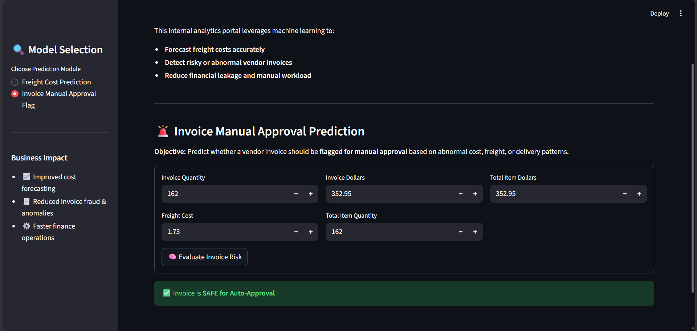

# Vendor Invoice Intelligence System

**Freight Cost Prediction & Invoice Risk Flagging**

<!-- After deploying, replace this comment with:
🔗 **Live App:** [your-app-link](your-app-link)
-->

---

## 📌 Table of Contents

- [Project Overview]
- [Business Objectives]
- [Data Sources]
- [Exploratory Data Analysis]
- [Models Used]
- [Evaluation Metrics]
- [End-to-End Application]
- [Project Structure]
- [How to Run This Project]
- [Limitations & Future Work]
- [Author & Contact]

---

## 📌 Project Overview

This project implements an end-to-end machine learning system designed to support finance teams by:

1. Predicting the expected **freight cost** for vendor invoices.
2. Flagging **high-risk invoices** that require manual review due to abnormal cost, freight, or operational patterns.

The models are served through a **Streamlit web application** so that non-technical users can get predictions in real time.

---

## 🎯 Business Objectives

### 1. Freight Cost Prediction (Regression)

**Objective:**
Predict the expected freight cost for a vendor invoice using quantity and invoice value.

**Why it matters:**

- Freight is a non-trivial component of landed cost.
- Poor freight estimation distorts margin analysis and budgeting.
- Early prediction improves procurement planning and vendor negotiation.
image

### 2. Invoice Risk Flagging (Classification)

**Objective:**
Predict whether a vendor invoice should be flagged for manual approval due to abnormal cost, freight, or delivery patterns.

**Why it matters:**

- Manual invoice review does not scale with transaction volume.
- Financial leakage often occurs in large or complex invoices.
- Early risk detection improves audit efficiency and operational control.



---

## 📂 Data Sources

Data is stored in a relational SQLite database (`inventory.db`) with the following tables:

- `vendor_invoice` – Invoice-level financial and timing data (5,543 invoices)
- `purchases` – Item-level purchase details
- `purchase_prices` – Reference purchase prices
- `begin_inventory`, `end_inventory` – Inventory snapshots

SQL aggregation (grouping purchases by PO number) is used to generate invoice-level features such as total item quantity, total item dollars and average receiving delay.

> The database is not included in this repository. Trained models are included, so the app runs without it.

---

## 📊 Exploratory Data Analysis (EDA)

EDA focuses on business-driven questions, such as:

- **Does freight cost depend on quantity and invoice value?**
  Yes. Freight has a correlation of about **0.98 with invoice dollars** and **0.95 with quantity**.
- **Does freight scale linearly with quantity?**
  Mostly. Small orders (below the 25th percentile, 83 units) cost about **$0.095 per unit** in freight, while large orders (above 5,100 units) cost about **$0.049 per unit**, so bulk orders are cheaper per unit.
- **Do flagged invoices have higher financial exposure?**
  Compared using flagged vs normal invoice groups.

Statistical tests (Welch's t-tests) are used to confirm that flagged invoices differ meaningfully from normal invoices.

### Risk labeling logic

An invoice is labeled **high-risk (1)** when either condition is true:

- The absolute difference between `invoice_dollars` and `total_item_dollars` is greater than **$5**, or
- The average receiving delay is greater than **10 days**.

Otherwise it is labeled **normal (0)**.

---

## 🤖 Models Used

### Regression (Freight Prediction)

- Linear Regression (**final model**)
- Decision Tree Regressor
- Random Forest Regressor

### Classification (Invoice Flagging)

- Logistic Regression (baseline)
- Decision Tree Classifier
- Random Forest Classifier (**final model**, tuned with GridSearchCV)

Hyperparameter tuning is performed using **GridSearchCV with F1-score** to handle class imbalance. Features are standardized with `StandardScaler` before training.

**Flagging model input features:** `invoice_quantity`, `invoice_dollars`, `Freight`, `total_item_quantity`, `total_item_dollars`

---

## 📈 Evaluation Metrics

### Freight Prediction

Metrics: **MAE**, **RMSE**, **R² Score**

| Model | MAE | RMSE | R² |
|---|---|---|---|
| **Linear Regression (final)** | **24.11** | **124.72** | **96.99%** |
| Decision Tree Regressor | 38.12 | 138.25 | 96.30% |
| Random Forest Regressor | 26.13 | 134.79 | 96.48% |

Linear Regression performed best, so the simplest model was chosen as the final one.

The deployed model uses both **Quantity** and **Invoice Dollars** and scores **MAE 24.46** and **R² 97.00%** on the test set.

### Invoice Flagging

Metrics: **Accuracy**, **Precision, Recall, F1-score**, **Classification report**, **Feature importance analysis**

**Final model: Random Forest Classifier (GridSearchCV, F1-optimized)**

Best parameters: `criterion='gini'`, `max_depth=None`, `min_samples_leaf=1`, `min_samples_split=5`, `n_estimators=100`

**Overall accuracy: 89%**

| Class | Precision | Recall | F1-score | Support |
|---|---|---|---|---|
| Normal (0) | 0.86 | 0.98 | 0.92 | 725 |
| Flagged (1) | 0.96 | 0.71 | 0.81 | 384 |

When the model flags an invoice it is almost always correct (precision 0.96), and it catches about 71% of all risky invoices (recall 0.71).

---

## 🖥 End-to-End Application

A Streamlit application demonstrates the complete pipeline:

- Input invoice details
- Predict expected freight cost
- Flag invoices in real time
- Show a clear decision: **Manual Approval Required** or **Safe for Auto-Approval**

---

## 📁 Project Structure

```
Freight-Cost-Prediction-App/
├── app.py                      # Streamlit web app
├── train_and_save_models.py    # Trains both models and saves them
├── requirements.txt            # Python dependencies
├── README.md
├── .gitignore
├── data/
│   └── inventory.db            # SQLite database (local only, not on GitHub)
├── inference/
│   ├── __init__.py
│   ├── predict_freight.py      # Loads freight model and predicts
│   └── predict_invoice_flag.py # Loads flag model + scaler and predicts
├── models/
│   ├── freight_model.pkl
│   └── invoice_flag_model.pkl  # Contains the model and its scaler
├── notebooks/
│   ├── Predecting_Fright_Cost.ipynb
│   └── Invoiceflagging.ipynb
└── images/
    ├── freight_prediction.png
    └── invoice_flagging.png
```

---

## How to Run This Project

**1. Clone the repository**

```bash
git clone https://github.com/IShraddha8/Freight-Cost-Prediction-App.git
cd Freight-Cost-Prediction-App
```

**2. Install dependencies**

```bash
pip install -r requirements.txt
```

**3. (Optional) Retrain the models**

Place `inventory.db` inside the `data/` folder, then run:

```bash
python train_and_save_models.py
```

This saves `models/freight_model.pkl` and `models/invoice_flag_model.pkl`. Trained models are already included, so you can skip this step.

**4. Open the application**

```bash
streamlit run app.py
```

---

## 🔭 Limitations & Future Work

- The risk label is rule-based (dollar mismatch and receiving delay), so the classifier largely learns that rule. Labels from real audit outcomes would make the model more meaningful.
- Freight is modeled from quantity and invoice value only. Vendor, distance, and shipping method could improve accuracy.
- Future work: add SHAP-based explanations, vendor-level analytics dashboards, and batch prediction from uploaded CSV files.

---

## 📬 Author & Contact

**Shraddha Ingole**
Data Scientist

📧 Email: [shraddhaingole894@gmail.com]
🔗 [LinkedIn](https://www.linkedin.com/in/shraddha-i-bb8811412)
🔗 [GitHub](https://github.com/IShraddha8)
